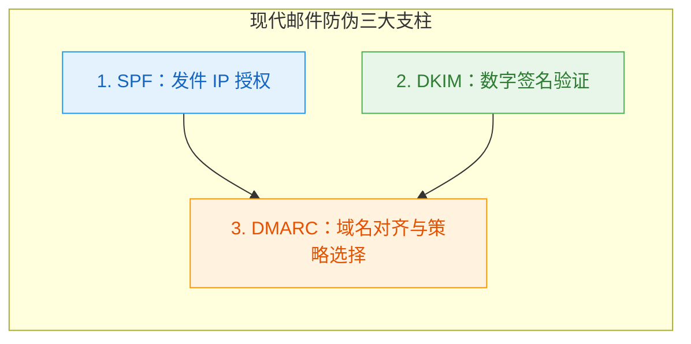

在数字化生活中，拥有一个以自己域名为后缀的专属邮箱（如 `admin@yourdomain.com`）：
- 可以为不同服务定制独立邮箱别名
- 可以临时注册一些你不信任的网站
> [!TIP]
> 域名邮箱不是万能的，很多网站都只接受主流邮箱注册，域名邮箱不能替代主流邮箱。

传统的域名邮箱方案往往伴随着极高的实施成本：
- **自建邮件服务器（Postfix + Dovecot 等）**：维护成本较高；
- **商业企业邮箱（Google Workspace、Fastmail 等）**：功能完备，但按人头/按月计费，对多域名、轻量自用或测试场景而言开销太大。

本文介绍一套**无服务器轻量化方案**：
> 利用 **Cloudflare Email Routing + Cloud Mail** 负责无服务器收信与别名管理，由现代邮件交付平台 **Resend** 提供高信誉 SMTP 发信通道，最后接入 **Gmail** 实现无感代发。

---

### 准备清单与依赖工具

1. **已接入 Cloudflare 的域名**：托管 DNS 并承载 Email Routing；
2. **GitHub 账号**：用于在 Cloudflare Pages/Workers 上部署开源面板；
3. **[Cloud Mail](https://github.com/maillab/cloud-mail)**：轻量漂亮的无服务器邮件管理系统（基于 Svelte + Cloudflare D1/KV）；
4. **[Resend](https://resend.com/) 账号**：现代开发者发信平台（免费计划提供每月 3000 封发信额度，完全满足个人与轻量需求）；
5. **日常使用的 Gmail 账号**：充当主收发客户端。

---

## 1. 收信基础设施：部署 Cloud Mail 面板

Cloud Mail 利用 Cloudflare 的边缘计算与轻量数据库能力，将邮件管理界面直接跑在 Cloudflare Workers/Pages 上，免去自建服务器的麻烦。

### 核心部署流程简析

1. **Fork 代码库**：访问 [maillab/cloud-mail](https://github.com/maillab/cloud-mail)，将其 Fork 至自己的 GitHub 仓库；
2. **在 Cloudflare 创建项目**：
   - 登录 Cloudflare Dashboard -> **Compute (Workers & Pages)** -> **Create application** -> **Pages** -> 连接 GitHub 仓库；
   - 框架预设选择自动，按官方 [部署指南](https://doc.skymail.ink/guide/dashboard.html) 绑定 D1 数据库实例与 KV 命名空间；
3. **初始化与路由关联**：
   - 绑定自己的访问域名，访问面板完成管理员账号注册与数据库初始化；
   - 在 Cloudflare 域名控制台的 **Email Routing（邮件路由）** 中启用服务，系统会自动下发对应的 MX 解析与 SPF 基础记录，并将入站规则交由 Cloud Mail 的 Worker 处理。

至此，发往该域名的入站邮件已经能被 Cloud Mail 完整接收并存储在面板中。

---

## 2. 发信基础设施：配置 Resend 与邮件认证三大支柱

Cloudflare Email Routing 官方仅提供收信转发能力，并不提供出站 SMTP 服务器。为了以自己的域名对外发送邮件，我们需要接入 Resend。

### 步骤 1：添加并验证域名

1. 登录 Resend 后台，在左侧导航进入 **Domains**，点击 **Add domain** 输入自己的根域名：

2. 点击跳转到 Cloudflare 自动一键添加 DNS 记录，或手动添加 Resend 提供的三条记录：
   - 用于发信来源认证的 **SPF** TXT 记录；
   - 用于内容防篡改数字签名的 **DKIM** CNAME 记录；
   - 邮件回执 MX 记录。
3. 等待状态刷新为 **Verified**。

### 步骤 2：加固 DMARC 防护记录

Resend 默认不会自动生成主域名的 DMARC 记录。为了防止黑客仿冒你的域名实施钓鱼，必须在 Cloudflare DNS 中显式注入一条 DMARC 策略：

| 记录类型 | 名称 (Name) | 内容 (Content) | 代理状态 | TTL |
| :--- | :--- | :--- | :--- | :--- |
| **TXT** | `_dmarc` | `"v=DMARC1; p=reject;"` | 仅 DNS (灰云) | Auto |

---

> [!TIP]
> `p=reject` 是最为严格的策略：一旦收信方发现邮件既无有效 SPF 也无有效 DKIM 签名，将直接拒绝接收。

### 步骤 3：获取 API Key 并绑定至 Cloud Mail

1. 在 Resend 后台进入 **API Keys** 页面，创建名为 `CloudMail-Sender` 的 Key 并立刻复制保存：

2. 打开 Cloud Mail 管理面板 -> **系统设置** -> 找到 **Resend Token**，粘贴该 Key 并保存：

完成该步骤后，Cloud Mail 便具备了完整的收信与在线发信能力。

---

## 3. 接入日常主力 Gmail

日常生活中，我们不可能每天频繁登录 Cloud Mail 网页端查信。最舒服的工作流是：**邮件自动汇入日常的个人 Gmail 收件箱，且在 Gmail 点击“回复”时，默认以域名邮箱的身份发送。**

### 第一步：收信自动流转至 Gmail

1. 进入 Cloudflare 域名控制台 -> **Email Routing** -> **Destination addresses（目标地址）**；
2. 添加你的个人 Gmail 邮箱，在 Gmail 中查收来自 Cloudflare 的验证邮件并点击激活链接：

3. 回到 Cloud Mail 面板 -> **系统设置** -> **邮件推送** -> 在 **第三方邮箱** 中填入刚刚验证过的 Gmail 地址并开启：

如此一来，所有寄往自定义域名的邮件都会推送至 Gmail。

---

### 第二步：配置 Gmail 代发（Send mail as）

利用 Gmail 原生支持的外接 SMTP 功能，结合 Resend 的发信网关完成绑定：

1. 在 PC 浏览器中打开 Gmail -> 点击右上角齿轮 -> **查看所有设置**：

2. 点击 **账号和导入 (Accounts and Import)** 标签页 -> 找到 **用这个地址发送邮件 (Send mail as)** -> 点击 **添加其他电子邮件地址**：

3. 填入发信人对外展示的姓名以及你的域名邮箱地址（如 `admin@starshadow.cc`），勾选“作为别名处理”：

4. **填写 Resend SMTP 网关参数**（关键步骤）：

| 参数项 | 配置值 | 说明 |
| :--- | :--- | :--- |
| **SMTP 服务器** | `smtp.resend.com` | Resend 官方发信终端 |
| **端口** | **`465`** | 必须搭配 SSL 加密 |
| **用户名** | `resend` | 固定字符，不能写成自己邮箱 |
| **密码** | `re_xxxxxxxxxxxx` | 之前在 Resend 生成的 API Key |
| **加密连接** | **SSL** | 465 端口强行要求显式 SSL |

5. 点击“添加账号”后，Gmail 会向该域名邮箱发送一封包含验证码与确认链接的邮件；
6. 检查 Cloud Mail 面板或已自动转发过来的 Gmail 收件箱，点击确认链接完成授权：

7. 刷新 Gmail 设置页面，将刚刚添加的域名邮箱点击设置为 **默认 (Make default)**：

从此，无论是写新邮件还是直接回复，Gmail 都会默认使用该域名邮箱通过 Resend 发送，对外呈现自己的域名身份！

---

## 4. 验证（可选）

### 验证步骤

1. **入站测试**：使用第三方邮箱（如 Outlook 或 QQ 邮箱）给 `admin@你的域名` 发信，确认 Cloud Mail 存储成功，且个人 Gmail 顺利收到镜像转发；
2. **出站测试**：在 Gmail 中以该域名邮箱为发件人向外部邮箱发信，确认是否是自己的域名。

### 常见踩坑与排障自查

#### Q1: Gmail 添加 SMTP 时报错“无法连接到服务器”？
* **核心诱因**：端口与加密协议不匹配。在邮件协议中，**465 端口属于 Implicit SSL（隐式 SSL）**，连接建立时立刻进行 TLS 握手；而 **587 端口属于 Explicit TLS (STARTTLS)**，先以明文建立连接再升级。如果你填写了 465 端口却勾选了 TLS，或者填了 587 端口勾选了 SSL，都会导致握手超时。

#### Q2: 为什么 Gmail 迟迟收不到确认邮件？
* **排查逻辑**：
  1. 先去 Cloudflare 控制台的 Email Routing 日志查看是否有丢件或拒收；
  2. 再看 Cloud Mail Web 面板是否有记录。若 Cloud Mail 有但 Gmail 没有，说明 Cloud Mail 的第三方推送未配置成功；
  3. 若两边都没有，检查域名 DNS 的 MX 记录是否被其他解析污染。

#### Q3: 为什么发出的邮件会被某些外企服务拒收？
* 域名邮箱在很多反垃圾邮件引擎（如 Spamhaus、Barracuda）中属于高风险特征。建议前期避免批量群发，正常使用并保持规范的 SPF/DKIM/DMARC 签名。

---

## 5. 总结

借助现代边缘基础设施，搭建一套可用且完全私有的域名邮箱系统。

- **Cloudflare Email Routing** 为我们承接了全球 Anycast 入站清洗；
- **Cloud Mail** 提供了无需管理主机的轻量控制中心；
- **Resend** 赋予了我们工业级的可靠发信能力与信誉保障；
- **Gmail** 则作为日常工作流的无感交互终端。

